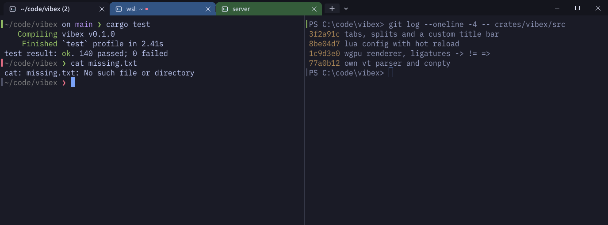
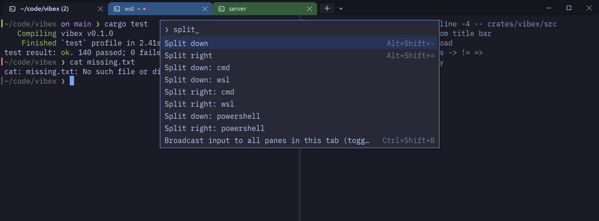
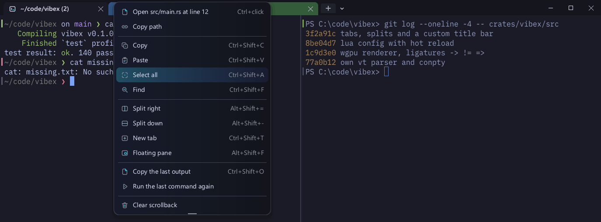
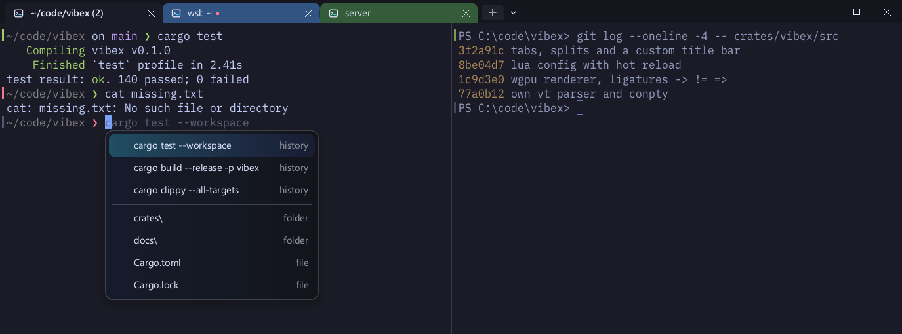
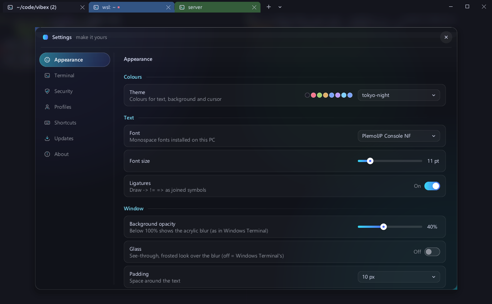
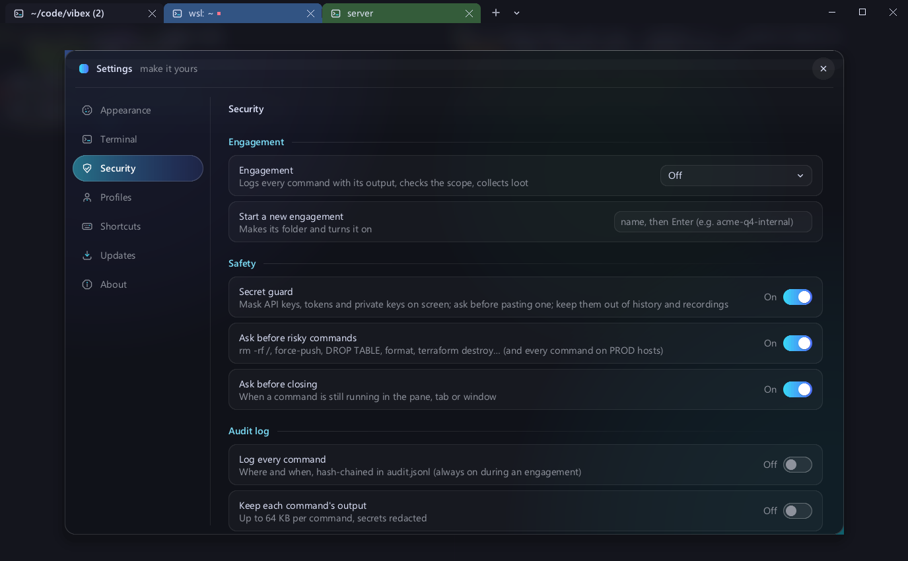

<p align="center">
  
</p>

<h1 align="center">Vibex Terminal</h1>

<p align="center">
  A fast, scriptable terminal for Windows, written from scratch in Rust.<br>
  Its own VT parser, screen model, ConPTY layer and GPU renderer, configured in Lua.
</p>

<p align="center">
  <a href="https://github.com/Kalyan-Deva/vibex/releases/latest"></a>
  <a href="https://github.com/Kalyan-Deva/vibex/actions/workflows/ci.yml"></a>
  <a href="#license"></a>
  
</p>

<p align="center">
  
</p>

---

## Why Vibex

- **Everything is built in, nothing is a plugin.** Command blocks, history search, suggestions, recording, screenshots, inline images, a secret guard and an audit log all ship in one 30 MB installer.
- **Both kinds of commands, in every shell.** `ls -la`, `grep -rn`, `rm -rf`, `which` and `ps aux` work in PowerShell and cmd. `where`, `ipconfig` and `cls` work in WSL. `nano` and Neovim come bundled.
- **Safe by default.** API keys and tokens are masked as they appear, risky commands ask before they run, and nothing you export or record leaks a secret.
- **Yours from A to Z.** One Lua file (`vibex.lua`) controls everything, with hot reload, events, key bindings, a leader key and a scriptable status bar. There's also a Settings window for the everyday options.

## Install

**Installer (recommended):** download `Vibex-Setup-<version>.exe` from [Releases](https://github.com/Kalyan-Deva/vibex/releases/latest) and run it.

- It installs per user, needs no admin, and adds a Start-menu entry, *Open in Vibex* in Explorer, and `vibex` on PATH.
- It isn't code-signed yet, so Windows SmartScreen may warn the first time: choose *More info* → *Run anyway*.
- The release page lists the SHA-256 so you can verify the download.

**From source:**

```powershell
git clone https://github.com/Kalyan-Deva/vibex
cd vibex
cargo build --release -p vibex
target\release\vibex.exe
```

- `tools\package.ps1` builds the full installer, including the bundled editors.
- See [docs/INSTALL.md](docs/INSTALL.md) for what setup changes and how to uninstall.

**Shell integration** (prompt marks, command blocks, the Linux/Windows commands): add one line to your PowerShell `$PROFILE` or `~/.bashrc`, as described in [docs/SHELL_INTEGRATION.md](docs/SHELL_INTEGRATION.md).

## Quick start

Open Vibex and try a few things:

```powershell
ls -la                           # Linux commands work in PowerShell
cat notes.txt | grep -n TODO
vshow --width 40 logo.png        # an image, right in the terminal
vshow README.md                  # Markdown, rendered
nano notes.txt                   # nano and Neovim come bundled
```

- <kbd>Ctrl</kbd>+<kbd>Shift</kbd>+<kbd>P</kbd> opens the command palette, which lists every action with its key.
- <kbd>Ctrl</kbd>+<kbd>,</kbd> opens Settings. Try *Appearance → Style* and *Appearance → Theme*.
- <kbd>Alt</kbd>+<kbd>Shift</kbd>+<kbd>=</kbd> splits the pane, and <kbd>Ctrl</kbd>+<kbd>Shift</kbd>+<kbd>T</kbd> opens a new tab.

## Features

### Terminal
- **Own engine:** a DEC/ANSI parser, screen and scrollback with reflow, alternate screen, scroll regions, and xterm modifier keys.
- **Rendering:** wgpu (DirectX 12 / Vulkan) with a CPU fallback and a hand-written glyph rasteriser. It supports ligatures, COLR v0/v1 colour emoji, and full grapheme clusters (ZWJ families, flags, skin tones).
- **Two styles, one click apart** (Settings → Appearance → Style, or `vibex cli style vibex|dragon`):
  - *Vibex*: a frameless window with its own tab bar, rounded corners, and acrylic or glass transparency.
  - *Dragon (Kali Linux)*: Kali's colours (Dragon Dark), its two-line `┌──(user㉿host)-[~]` prompt, its coloured `ls`, and a classic title bar with a menu bar, all taken from Kali's own configuration. See [The Kali Linux look](docs/CONFIG.md#the-kali-linux-look).
  - Switching back to *Vibex* takes every Dragon setting off again, and each piece (theme, prompt, title bar) can also be set on its own in `vibex.lua`.
- **54 built-in themes**, light and dark: Catppuccin, Dracula, Nord, One Dark, Monokai, Gruvbox, Solarized, Tokyo Night, Rosé Pine, Kanagawa and more, or your own colours. Smooth scrolling throughout.
- **Inline images:** sixel and the kitty graphics protocol. `vshow` draws PNGs and rendered Markdown right in the terminal, with `--width`, `--height`, `--fit`, `--scale 50%`, `--center` and more. An image taller than the window is shrunk to fit, and the prompt always comes back below it.
- **Modern protocols:** OSC 8 hyperlinks, OSC 52 clipboard, OSC 9/777 notifications, the kitty keyboard protocol, IME input, and Ctrl+click on URLs and `path:line`.
- **Accessibility:** screen readers through UI Automation.

### Windows, tabs and panes
- Tabs: drag, rename, colour, and drag a tab into another window or out into a new one.
- Splits with draggable dividers and zoom. Floating panes and popups over a tab.
- A Quake-style dropdown on <kbd>Win</kbd>+<kbd>`</kbd> from anywhere.
- Workspaces and saved layouts. **Detach** a window with its shells still running, then bring it back with `vibex attach`.
- Sessions restore on start, scrollback included. Reopen a closed tab, and get asked before closing anything that's still running.
- Focus mode: full screen, no bars, notifications held back.

### Commands
- **Command blocks** (with shell integration):
  - green and red exit marks in the gutter, and a sticky header for the running command
  - copy the last output, run the last command again, jump between prompts
  - a notification when a long command finishes
- **History search** across every pane, window and past session (<kbd>Ctrl</kbd>+<kbd>Shift</kbd>+<kbd>H</kbd>).
- **Suggestions** as you type, from your history (<kbd>→</kbd> accepts). **Completions** for commands and files (<kbd>Ctrl</kbd>+<kbd>Shift</kbd>+<kbd>Space</kbd>).
- **Command palette** with fuzzy search over every action, profile, layout and workspace.
- **Quick select** copies hashes, paths, URLs and IPs with two keystrokes. **Vi copy mode** has block selection. **Search** supports regex and match-case.
- **Broadcast input** to every pane in a tab. An **SSH host picker** reads `~/.ssh/config` and `known_hosts`, and SSH tabs can be coloured per host.
- **Linux and Windows commands** in every shell, explained in [Linux and Windows commands](docs/CONFIG.md#linux-and-windows-commands):
  - PowerShell gets `ls -la`, `grep -rn`, `find . -name`, `rm -rf`, `which`, `ps aux`, `kill -9`, `df -h`, `lsof -i :3000` and `export`.
  - Pasted one-liners such as `a && b || c` and `2>/dev/null` work in PowerShell 5.1.
  - WSL gets `where`, `ipconfig`, `tasklist`, `start` and `clip`, and any `.exe` runs without its extension.
- **nano and Neovim bundled.** Vibex checks for new releases once a week and every update is verified by SHA-256. See [nano and Neovim](docs/CONFIG.md#nano-and-neovim).

### Capture and share
- **Screenshots:**
  - the pane, or the last command with a title bar showing its exit code and duration
  - copy a selection as an image
  - all in your theme and font
- **Save any lines:** mark a start and an end, or use a selection or a command. Save as PNG, text, ANSI, HTML, SVG or Markdown.
- **Recording:** asciicast recordings of a pane, played back in Vibex or turned into a GIF.
- **Notes beside a pane**, saved per folder.

### Security
- **Secret guard:**
  - API keys, tokens and private keys are masked on screen as they appear, including across wrapped lines
  - pasting a secret asks first
  - secrets are kept out of history and recordings, and blurred in every export
- **Risky-command check:** `rm -rf /`, a force-push, `DROP TABLE`, `format` or `terraform destroy` asks before Enter runs it. On hosts you mark as production, every command asks.
- **Audit log:** every command is logged with where and when it ran, optionally with its output (secrets redacted). Entries are hash-chained, so tampering shows, and you can export it as an HTML report.
- **Engagement mode** for security testing:
  - a scope guard warns before a command touches a target outside scope
  - findings are collected automatically (open ports, hashes, credentials)
  - recordings are kept, and you get a report at the end

### Make it yours
- `vibex.lua` with hot reload and in-window errors. It covers themes, fonts, key bindings with a leader key, profiles, events, triggers, a scriptable status bar, and Lua callbacks with a `win` API.
- A **Settings window** for the everyday options, with dropdowns, toggles and a shortcut editor.
- **Remote control:** `vibex cli` lists, spawns, splits, sends text, reads text, exports and runs actions from scripts.
- **Signed updates** (Ed25519), and a per-user installer with an uninstaller.

## Screenshots

| Command palette | Right-click menu |
|---|---|
|  |  |
| **Suggestions and completions** | **Settings** |
|  |  |
| **Secret guard and risky-command check** | |
|  | |

## Shortcuts

The ones you'll use every day are below. The full list is in **[SHORTCUTS.md](SHORTCUTS.md)**. <kbd>Ctrl</kbd>+<kbd>Shift</kbd>+<kbd>P</kbd> shows every action with its key.

| | |
|---|---|
| Command palette | <kbd>Ctrl</kbd>+<kbd>Shift</kbd>+<kbd>P</kbd> |
| New tab / close pane | <kbd>Ctrl</kbd>+<kbd>Shift</kbd>+<kbd>T</kbd> / <kbd>Ctrl</kbd>+<kbd>Shift</kbd>+<kbd>W</kbd> |
| Split right / down | <kbd>Alt</kbd>+<kbd>Shift</kbd>+<kbd>=</kbd> / <kbd>Alt</kbd>+<kbd>Shift</kbd>+<kbd>-</kbd> |
| Copy / paste | <kbd>Ctrl</kbd>+<kbd>Shift</kbd>+<kbd>C</kbd> / <kbd>Ctrl</kbd>+<kbd>Shift</kbd>+<kbd>V</kbd> |
| Find | <kbd>Ctrl</kbd>+<kbd>Shift</kbd>+<kbd>F</kbd> |
| Search history | <kbd>Ctrl</kbd>+<kbd>Shift</kbd>+<kbd>H</kbd> |
| Screenshot the pane | <kbd>Alt</kbd>+<kbd>Shift</kbd>+<kbd>S</kbd> |
| Settings | <kbd>Ctrl</kbd>+<kbd>,</kbd> |

## Configure

`%USERPROFILE%\.config\vibex\vibex.lua` is plain Lua that returns a table. Save it and Vibex reloads it straight away:

```lua
local act = require("vibex").action
return {
  theme = "tokyo-night",
  font_size = 12,
  opacity = 0.9,
  default_profile = "pwsh",
  profiles = {
    pwsh = { cmd = { "pwsh.exe", "-NoLogo" } },
    wsl  = { cmd = { "wsl.exe", "~" } },
  },
  keys = {
    { key = "|", mods = "CTRL|SHIFT", action = act.SplitRight },
  },
}
```

Every option, event and action is in [docs/CONFIG.md](docs/CONFIG.md). Run `vibex --check-config` to validate the file without opening a window.

## Documentation

| | |
|---|---|
| [SHORTCUTS.md](SHORTCUTS.md) | the default keys and mouse actions |
| [docs/CONFIG.md](docs/CONFIG.md) | configuration and every feature in depth |
| [docs/KEYS.md](docs/KEYS.md) | the full key reference, including the leader-key layer |
| [docs/SHELL_INTEGRATION.md](docs/SHELL_INTEGRATION.md) | PowerShell and bash scripts, and the escape sequences they use |
| [docs/INSTALL.md](docs/INSTALL.md) | the installer, command line, updates and releasing |
| [docs/ARCHITECTURE.md](docs/ARCHITECTURE.md) | how the crates fit together |
| [CHANGELOG.md](CHANGELOG.md) | what changed in each release |
| [CONTRIBUTING.md](CONTRIBUTING.md) / [SECURITY.md](SECURITY.md) | building and testing, and reporting a security problem |

## Project layout

| Crate | What it does |
|---|---|
| `vibex-vt` | escape-sequence parser (DEC/ANSI state machine) and UTF-8 decoder, no dependencies |
| `vibex-term` | screen, scrollback, reflow, selection, command blocks, images, links |
| `vibex-pty` | ConPTY and OpenConsole on Windows, `posix_openpt` on Unix |
| `vibex-render` | scene building, fonts and shaping, the CPU and GPU backends, icons |
| `vibex` | the app: windows, input, Lua, palette, sessions, every feature above |
| `vibex-update` | signed update feed and HTTP |
| `vibex-setup` | the per-user installer |
| `vibex-launcher` | `vibex.com`, so shells wait for CLI output |
| `vibex-release` | release signing tool |

## Status

**Windows 10 and 11** are the main platform, and Vibex is used there daily.

**Linux** builds and passes its tests, including a real pty and headless rendering. **macOS** compiles. Neither has an installer yet, and the single-instance hand-off is Windows-only.

**Planned:** packaging for Linux, listing in Windows' *default terminal* setting (needs MSIX), and winget.

## Contributing

Issues and pull requests are welcome. See [CONTRIBUTING.md](CONTRIBUTING.md) for building, testing and the code style. To report a security problem, see [SECURITY.md](SECURITY.md).

## License

Vibex is dual-licensed under either of

- [MIT license](LICENSE-MIT)
- [Apache License, Version 2.0](LICENSE-APACHE)

at your option. Unless you say otherwise, any contribution you submit for inclusion is dual-licensed the same way, without any extra terms.

The installer also ships third-party programs under their own licences: OpenConsole (MIT), Neovim (Apache-2.0 and the Vim licence), and GNU nano with its MSYS2 runtime (GPL-3.0 and others). See [THIRD_PARTY_NOTICES.md](THIRD_PARTY_NOTICES.md).
